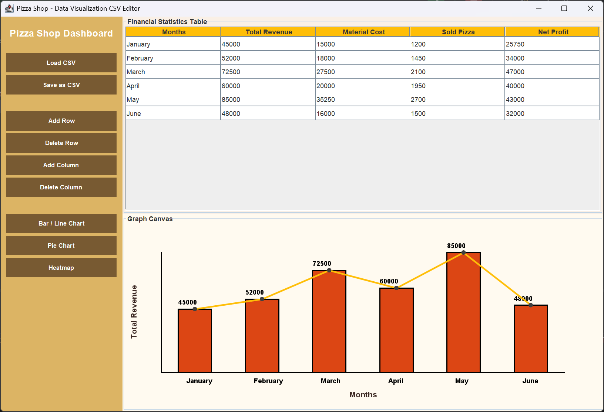

# Pizza Shop Dashboard CSV Editor

This project is a coursework assignment from the Data Visualisation and Communication course during my Erasmus exchange program. It is a Java Swing desktop application that loads and edits CSV files and visualizes the data as a bar/line chart, a pie chart and a heatmap.

No charting library is used. As the assignment required, every chart is drawn with basic Java 2D shapes (lines, rectangles, arcs), using hand-written formulas.



## Features

- Load a CSV file and show it in an editable table
- Add and delete rows and columns, and save the table as a CSV file
- Bar chart with a line chart drawn over it
- Pie chart with a label and value on each slice
- Heatmap of all data columns
- Charts resize with the window

## How to run

With Java 11 or newer:

```bash
java Main.java
```

Then click **Load CSV** and open `pizza.csv`, a sample data file I made to test the app.
